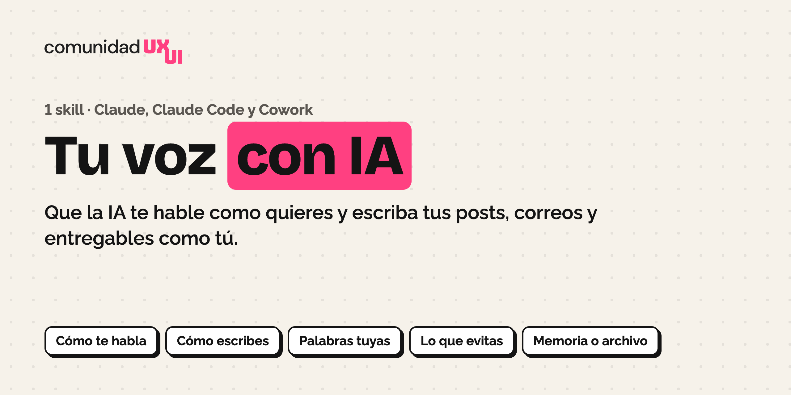
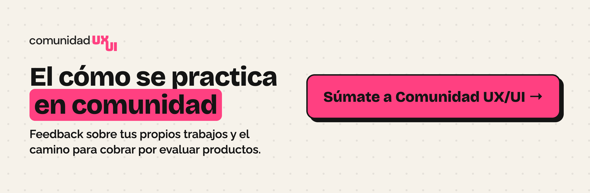

<p align="center"></p>

# Tu voz con IA

**Una skill para que la IA te hable como tú quieres y escriba tus posts, correos y entregables con tu voz,** en lugar del tono genérico que suena igual para todo el mundo.

[](LICENSE)
[](skills/)
[](#en-claude-code)
[](#)

---

## Qué resuelve

Cada día la IA te trata distinto: un día te adula, otro te explica de más, y lo que escribe por ti suena a cualquiera menos a ti. Esta skill arma tu perfil de voz y tono una sola vez, y separa dos cosas que suelen mezclarse:

| | Qué define | Para qué sirve |
|---|---|---|
| **Cómo te habla la IA** | Registro, nivel de feedback, formato, lo que no quieres | Que cada conversación arranque como te sirve |
| **Cómo escribes tú** | Tono, palabras que usas, muletillas que evitas | Que lo que la IA escribe en tu nombre suene a ti |

## Cómo trabaja

1. **Revisa lo que ya sabe de ti** (memoria e historial, si existen) y te muestra un borrador para validar.
2. **Te entrevista en tres bloques cortos**, de a uno, para completar lo que falta.
3. **Te pide textos tuyos reales** (un post, un correo) para basarse en tu escritura y no en una impresión.
4. **Arma el documento final** y te pregunta cómo guardarlo: en la memoria de la IA, como archivo o las dos cosas.

Con el archivo puedes llevar tu voz a cualquier herramienta: lo pegas en un chat nuevo y la IA ya sabe cómo hablarte.

## Cómo se usa

Pídelo con tus palabras: *«arma mi perfil de voz y tono»*, *«quiero que me conozcas mejor»*, *«escribe como yo»*.

## Instalación

### En claude.ai y en Cowork

1. Descarga `tu-voz.zip` desde **[Releases](https://github.com/CUXUI/tu-voz-con-ia/releases/latest)**.
2. En Claude, entra a **Personalizar → Skills → + → Subir una skill** y súbelo tal como lo descargaste.
3. Abre un chat nuevo y pide: *«arma mi perfil de voz y tono»*.

Guía paso a paso con capturas: **[cómo subir una skill a claude.ai](https://elegant-unicorn-d6c.notion.site/C-mo-instalar-una-skill-en-Claude-paso-a-paso-41afe4da3fb9819eaddac42060168977)**.

### En Claude Code

```
/plugin marketplace add CUXUI/tu-voz-con-ia
/plugin install tu-voz@tu-voz-con-ia
```

Después pide tu perfil o llama la skill directo: `/tu-voz`.

### En Codex, Cursor, Gemini CLI y otros agentes

```bash
npx skills add CUXUI/tu-voz-con-ia
```

Necesita Node.js 22.20 o superior. Si tu agente no instala skills, deja el repositorio en tu carpeta de trabajo y pídele que lea el `SKILL.md` de la carpeta `skills/` y lo siga.

## Qué hay adentro

```
skills/tu-voz/
└── SKILL.md   el protocolo: borrador, entrevista, documento final y cómo guardarlo
```

## Límites honestos

- **Sin textos tuyos, es una impresión.** La skill lo dice en el documento. Con dos o tres textos reales el resultado mejora mucho.
- **Describe cómo te comunicas, no quién eres.** No hace diagnósticos de personalidad.
- **No se actualiza solo.** Vuelve a correrla cada tanto o cuando sientas que la IA ya no te habla como necesitas.

---

## Tu voz, también en tu trabajo

Escribir con criterio, presentar tu trabajo y defender tus decisiones de diseño es lo que practicamos en **[Comunidad UX/UI](https://www.skool.com/comunidaduxui/about)**, con feedback de personas que trabajan en lo mismo que tú.

<p align="center"><a href="https://www.skool.com/comunidaduxui/about"></a></p>

¿Prefieres empezar por correo? Suscríbete a **[Minuto UX](https://comunidad-uxui.kit.com/fb40f8e711)**, el newsletter de Comunidad UX/UI.

<p align="center"><a href="https://comunidad-uxui.kit.com/fb40f8e711"></a></p>


## Licencia

[CC BY-NC-SA 4.0](LICENSE). Puedes usarla, adaptarla y compartirla citando a Comunidad UX/UI, sin uso comercial y con la misma licencia.
